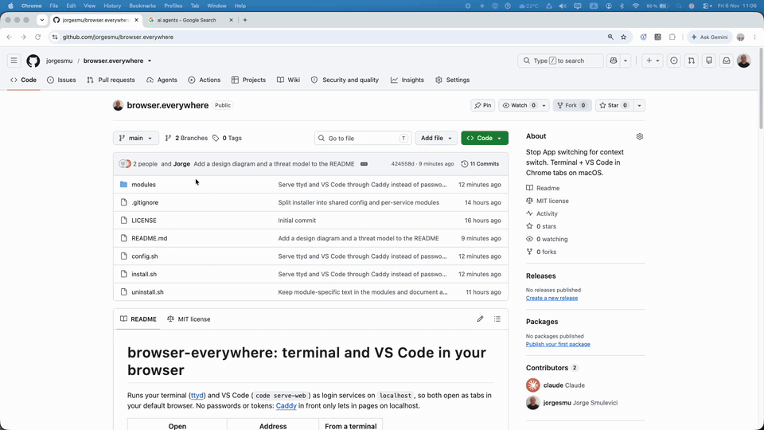
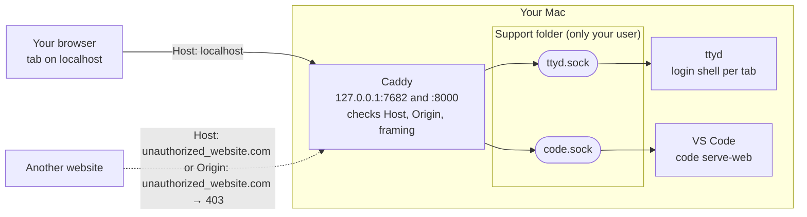

# browser-everywhere: terminal and VS Code in your browser

Runs your terminal ([ttyd](https://github.com/tsl0922/ttyd)) and VS Code (`code serve-web`) as login services on `localhost`, so both open as tabs in your default browser. No passwords or tokens: [Caddy](https://caddyserver.com) in front only lets in pages on localhost.

| Open | Address | From a terminal |
|---|---|---|
| Terminal (new shell per tab) | `http://localhost:7682` | `t [folder]` |
| VS Code | `http://localhost:8000` | `cw [folder]` |

Bookmark them as **terminal** and **vscode**, then type that word in the address bar and pick the bookmark.



## Requirements
- **macOS only.** It uses launchd for the services, `~/Library` for its files and `open` to launch your default browser, so it doesn't run on Linux or Windows.
- **[Homebrew](https://brew.sh)**, to install ttyd and Caddy. ttyd doesn't publish macOS builds, so Homebrew is the way to get it.
- **[VS Code](https://code.visualstudio.com)** and any browser (the `t`/`cw` shortcuts use your default one).

## Install
```
curl -fsSL https://raw.githubusercontent.com/jorgesmu/browser.everywhere/main/install.sh | bash
```
Or, from a clone: `./install.sh`. It's safe to re-run and needs no sudo. Piped like this, the script downloads the repo to a temporary folder, runs from there and then deletes it.

`install.sh` installs ttyd and Caddy with Homebrew if needed, and prints both addresses. Run it from a regular terminal, not a browser terminal tab: re-installing restarts ttyd, which closes those tabs.

## Uninstall
```
curl -fsSL https://raw.githubusercontent.com/jorgesmu/browser.everywhere/main/uninstall.sh | bash
```
Or, from a clone: `./uninstall.sh`. It removes the services, the t/cw shortcuts and the support folder, and leaves ttyd, Caddy and VS Code installed.

## Modules
Each service is a module: one file in `modules/` (`caddy.sh`, `ttyd.sh`, `code.sh`) that registers its label, its port and socket, and says how to set its service up. Both scripts read `config.sh` (shared paths and markers), which loads the modules listed in `modules/definition`, one name per line, in start order. Changing the list needs a clone: the `curl | bash` install always uses the repo's own `modules/definition`.

### Adding a module
1. Create `modules/<name>.sh`. [modules/README.md](modules/README.md#the-interface) describes what it must define and has an outline to start from.
2. Add `<name>` on its own line in `modules/definition`.
3. Run `./install.sh`.

### Turning a module off
1. If the module is already installed, remove its service first, or it keeps running at every login. [modules/README.md](modules/README.md#turning-a-module-off) shows how.
2. Delete its line from `modules/definition`, or comment it out with `#`. For example, to install only the terminal, remove `code`. Keep `caddy`: the other modules are served through it.
3. Run `./install.sh`.

## Design


- Caddy is the only service on a port. It forwards each port to a service's socket.
- ttyd and VS Code listen only on their sockets, so nothing reaches them except through Caddy.
- `t` and `cw` open `http://localhost:PORT/?…` in your default browser, the same address as the bookmarks.

## What it sets up
- `~/Library/LaunchAgents/local.caddy.plist`, `local.ttyd.plist` and `local.code.plist`: started at login, restarted if they crash.
- `~/Library/Application Support/browser-everywhere/` (only you can open it):
  - `ttyd.sock`, `code.sock`: where ttyd and VS Code listen. Only Caddy connects to them.
  - `Caddyfile` and `caddy/`: Caddy's settings and files.
  - `shell`: starts `$SHELL -l` in the folder from `?arg=`.
  - `logs/`: output from the services.
- `~/.local/bin/t` and `~/.local/bin/cw`: plain `sh` scripts, so they work from any shell. If `~/.local/bin` isn't on your `PATH`, `install.sh` prints the line to add for zsh, bash and fish. It never edits your shell config.

## Security
Nothing secret is stored: no passwords, no tokens, nothing in `ps`, the plists or the URLs. No certificates, no `/etc/hosts` changes, no root.

### Threat model
What it protects: a shell and an editor running as you. Anyone who reaches either can run any command as you.

| Threat | Protected? | How |
|---|---|---|
| Other computers on the network | Yes | Caddy listens on `127.0.0.1` only. |
| A website sending requests to `localhost` (CSRF, cross-site WebSocket) | Yes | The browser adds `Origin: unauthorized_website.com`, which pages can't fake. Caddy answers 403. |
| A website pointing its own name at `127.0.0.1` (DNS rebinding) | Yes | The browser still sends `Host: unauthorized_website.com`. Caddy only accepts `localhost` and `127.0.0.1`. |
| A website showing the terminal in a hidden frame (clickjacking) | Yes | `X-Frame-Options: SAMEORIGIN`: only the same page may frame it. |
| A website opening or linking to the terminal | Harmless | You get your own terminal in a tab. The other site can't read or type into it. |
| Stealing a password or token from files, `ps` or browser history | Nothing to steal | No secrets exist. |
| Another user account on the same Mac connecting to ttyd or VS Code directly | Yes | Their sockets are in a folder only your user can open. |
| Another user account on the same Mac connecting through Caddy | **No** | `127.0.0.1` is shared by every account. Fine on a single-user Mac. |
| Programs running as you (malware) | Out of scope | They can already run commands and read your files. |
| Browser extensions with "read all sites" access | Out of scope | They can see and control these tabs. Keep your extensions trustworthy. |
| Root or admin users | Out of scope | Root can do anything on the Mac. |
